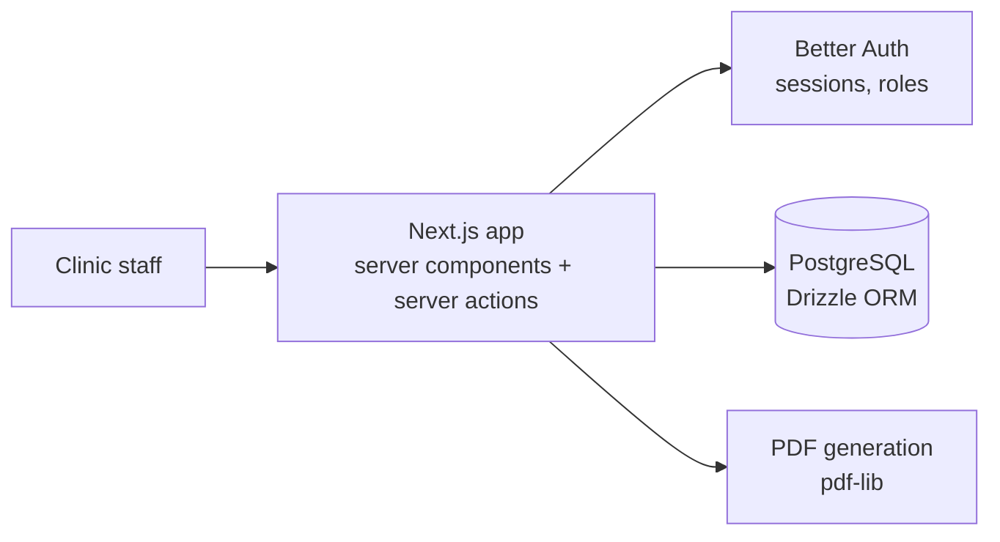

# Dental Clinic Management System — Case Study

> Management system for dental clinics: scheduling, patients, professionals and finance, installed per clinic on its own server.
> **Status: in development** (phase 1, the MVP that runs the clinic's schedule). **Source code is private.** This repository documents the project; a walkthrough is available on request.

## The problem

Small dental clinics run their schedule, patient records and payments across paper, spreadsheets and WhatsApp, and most off-the-shelf systems charge a monthly fee per user that doesn't fit their size.

## What it covers (phase 1)

- **Authentication, users, groups and permissions.**
- **Clinic units and opening hours**, holidays, professionals and procedures.
- **Schedule** with day, week and month views.
- **Patient records.**
- **Manual finance**: receivables and payables with filters, and a projected balance.
- **Dashboard**: today's schedule and what is due.

Later phases add clinical records, online booking and automated reminders.

## Architecture

- Next.js full stack (App Router) with Zod validation and Drizzle migrations.
- **One installation per clinic** on a server the clinic contracts, packaged with Docker.
- Tests with Vitest; seeded demo data with invented patients only.

## My role

Product definition, architecture and full stack development.

---
Built by **Victor Sestrem** · [LinkedIn](https://www.linkedin.com/in/victor-sestrem/) · victor-sestrem@hotmail.com
